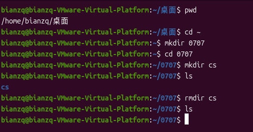
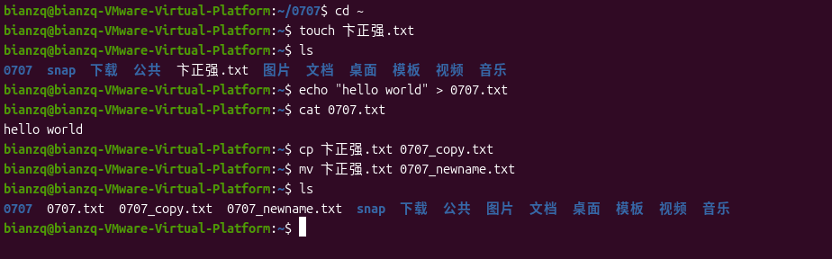
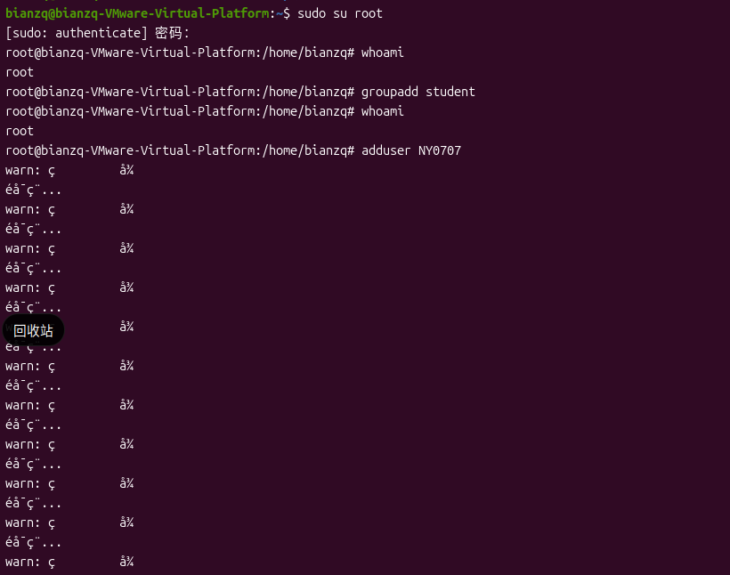
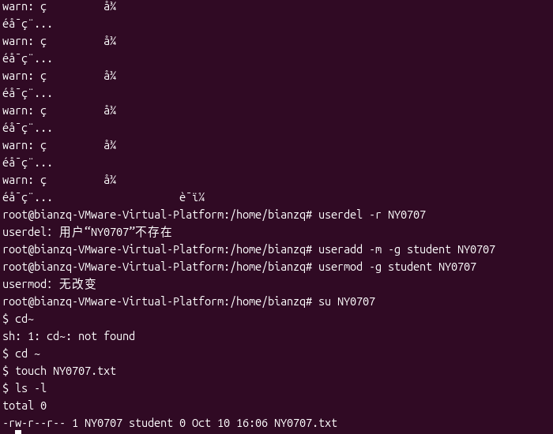
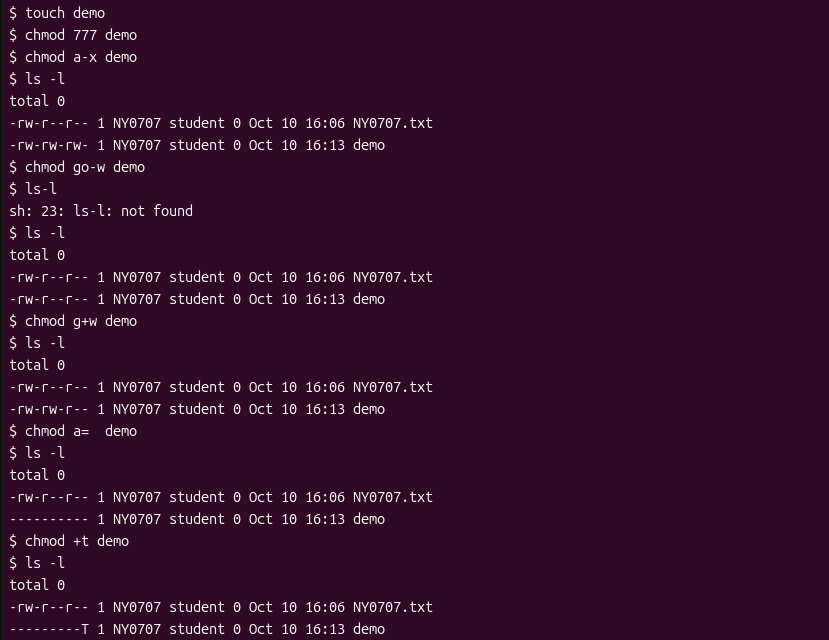
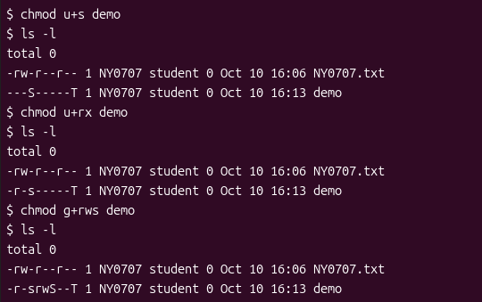
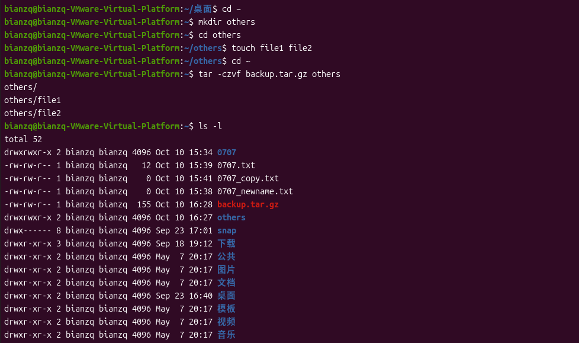
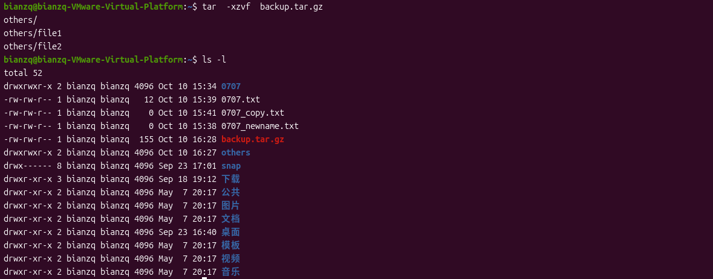
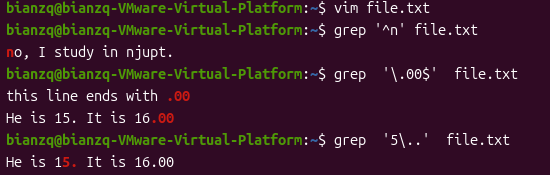

# 实验一：Linux 基本命令

## 1. 实验目的

通过实验熟悉 Linux 操作系统环境，掌握基本 Linux 命令的使用。

## 2. 实验要求

- 掌握 Linux 文件权限管理
- 掌握基本文件和目录操作
- Linux 用户管理
- 文件压缩与归档

## 3. 实验步骤

### 步骤1：目录操作

按顺序输入以下命令：

```bash
$ pwd
$ cd ~
$ mkdir 0707
$ cd 0707
$ mkdir cs
$ ls
$ rmdir cs
$ ls
```

**说明：** `pwd` 显示当前工作目录，`cd ~` 回到用户主目录。然后用 `mkdir` 创建以学号后4位命名的目录，并用 `cd` 进入该目录。在其中创建子目录 `cs`，再用 `rmdir` 将其删除。两条 `ls` 命令分别展示了删除 `cs` 前后的目录内容，可以确认 `cs` 已不存在。



### 步骤2：文件操作

按顺序输入以下命令：

```bash
$ cd ~
$ touch yourname.txt
$ ls
$ echo "hello world" > 0707.txt
$ cat 0707.txt
$ cp yourname.txt 0707_copy.txt
$ mv yourname.txt 0707_newname.txt
$ ls
```

**说明：** `touch` 创建一个以自己名字命名的空文件；`echo "hello world" > 文件名` 将字符串 "hello world" 写入以学号命名的文件，并用 `cat` 查看其内容；`cp` 把名字文件复制为另一个文件，`mv` 则将原文件重命名。最后一条 `ls` 列出主目录下所有文件，可以看到复制和重命名后的文件。



### 步骤3：用户管理

> 注意：以下命令中的 `0707` 为学号后4位。

按顺序输入以下命令：

```bash
$ whoami
$ sudo su root
```

输入当前登录用户的密码（不是root密码），然后输入：

```bash
# groupadd student
# whoami
# adduser NY0707
# usermod -g student NY0707
```

按照提示创建用户，并将该用户加入 `student` 组。然后切换到该用户：

```bash
# su NY0707
$ cd ~
$ touch NY0707.txt
$ ls -l
```

**说明：** `whoami` 显示当前用户，`sudo su root` 切换到 root 用户。以 root 身份用 `groupadd` 创建新组 `student`，用 `adduser` 创建新用户 `NY0707`（0707为学号后4位），再用 `usermod -g` 将其加入 `student` 组。用 `su` 切换到新用户后，在其主目录下创建文件 `NY0707.txt`。`ls -l` 的输出展示了该文件的详细信息，包括文件属主用户及其所属组。





### 步骤4：权限管理

按顺序输入以下命令，每输入一行后执行 `ls -l demo` 查看结果：

```bash
$ touch demo
$ chmod 777 demo
$ chmod a-x demo      # 结果为 rw-rw-rw-
$ chmod go-w demo     # 结果为 rw-r--r--
$ chmod g+w demo      # 结果为 rw-rw-r--
$ chmod a= demo       # 结果为 ---------
$ chmod +t demo       # 结果为 --------T
$ chmod u+s demo      # 结果为 --S-----T
$ chmod u+rx demo     # 结果为 r-s-----T
$ chmod g+rws demo    # 结果为 r-srwS--T
```

**说明：** 本步骤演示 `chmod` 修改文件权限的方法。先创建文件 `demo` 并赋予全部权限 `777`，随后每条 `chmod` 命令进行特定的权限修改——去掉所有人的执行权限（`a-x`）、去掉组和其他用户的写权限（`go-w`）、给组加上写权限（`g+w`）、清空所有权限（`a=`）、设置粘滞位（`+t`）、设置setuid位（`u+s`）等。每次修改后用 `ls -l demo` 查看权限字符串，结果与命令注释中的预期一致。





### 步骤5：其他管理

#### 5.1 文件压缩与归档

在用户主目录下创建文件夹 `others`，进入该文件夹，在其中任意创建两个文件。然后按顺序执行以下命令：

```bash
$ tar -czvf backup.tar.gz others
$ ls -l
$ tar -xzvf backup.tar.gz
$ ls -l
```

**说明：** `tar -czvf` 将 `others` 文件夹压缩归档为 `backup.tar.gz`，`tar -xzvf` 再将其解压还原。两条 `ls -l` 分别展示解压前后的目录内容，可以观察到过程中的变化（生成压缩包，随后解压还原出原文件夹）。





#### 5.2 使用 grep 搜索

创建一个文本文件 textfile，内容如下：

```text
no, I study in njupt.
this line ends with 00
this line ends with .00
I am 25 years old.
He is 15. It is 16.00
wy is the short of my name.
```

然后按顺序执行以下命令：

```bash
$ grep '^n' textfile
$ grep '\.00$' textfile
$ grep '5\..' textfile
$ grep '^[wy]' textfile
```

**说明：** 本步骤练习使用 `grep` 结合正则表达式进行文本搜索。四条命令分别搜索：以字母 "n" 开头的行（`^n`）；以 ".00" 结尾的行（`\.00$`）；包含数字5、后跟点号、再跟任意字符的行（`5\..`）；以及以 "w" 或 "y" 开头的行（`^[wy]`）。每条命令的输出即为文件中匹配的行。




