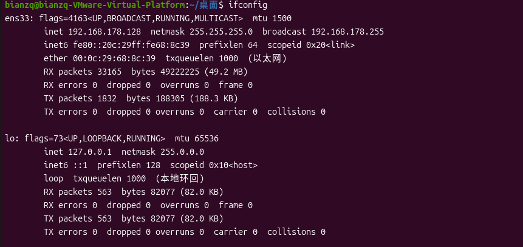
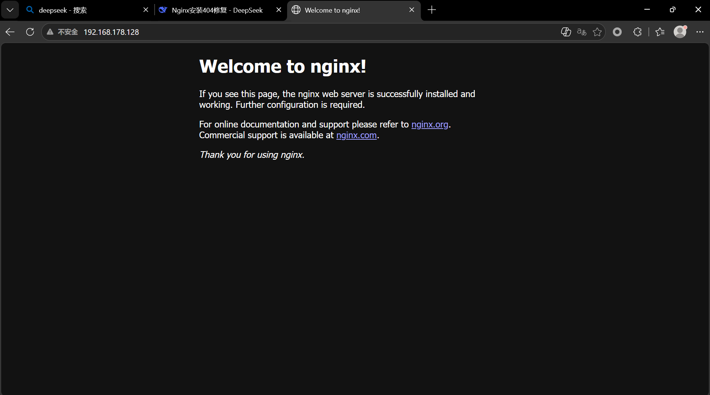
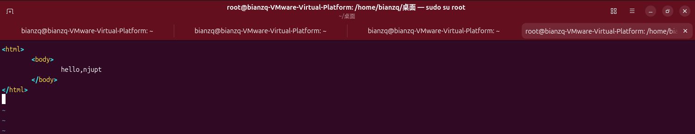
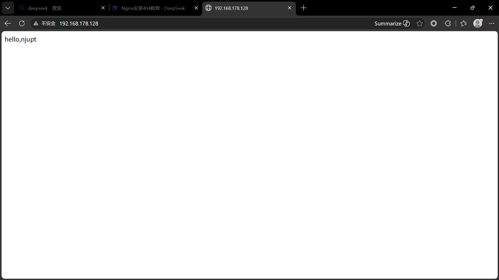

# 搭建第二个服务器 web服务器nginx

## 实验目标

搭建nginx服务器，允许远程访问。

## 完成情况总览

| 步骤 | 内容 | 完成情况 |
| ---- | ---- | -------- |
| 步骤1 | 安装nginx | ✅ 已完成 |
| 步骤2 | 查询虚拟机IP地址 | ✅ 已完成 |
| 步骤3 | Windows浏览器远程访问 | ✅ 已完成 |
| 步骤4 | 添加index.html到web根目录 | ✅ 已完成 |

## 实验步骤

### 步骤1：安装nginx

一条命令即可：

```bash
sudo apt install nginx -y
```

### 步骤2：查询虚拟机IP地址

```bash
ifconfig
```



### 步骤3：Windows浏览器访问

回到你的Windows，打开浏览器，输入IP地址。



### 步骤4：添加index.html到web根目录

输入 `sudo su root`，切换到root。

添加 `index.html` 到web根目录 `/var/www/html`，内容如下：

```html
<html><body>hello, njupt</body></html>
```

可以使用vi编辑器（`apt install vim`），也可以在图形界面下编辑。




