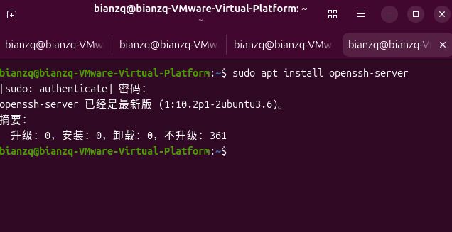
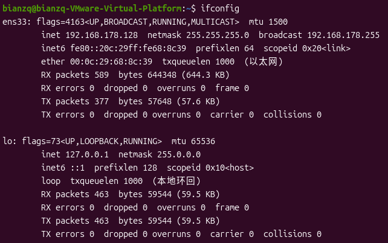
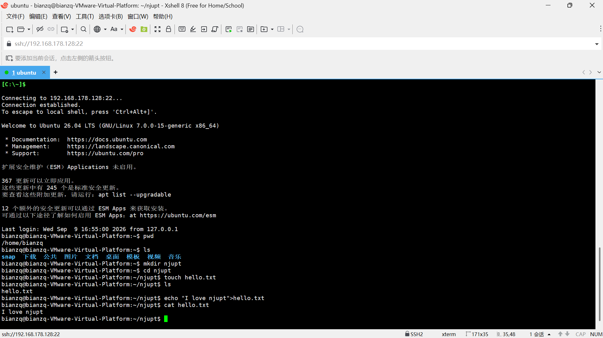

# 第二次作业报告：搭建第一个服务器 openssh-server

> 目标：搭建 ssh 服务器，允许远程访问。

## 完成情况总览

- [x] 步骤 1：安装 openssh-server
- [x] 步骤 2：查询虚拟机 IP 地址
- [x] 步骤 3：使用 Xshell 连接虚拟机
- [x] 步骤 4：在物理机上远程执行 Linux 命令

---

## 步骤 1：安装 openssh-server

一条命令即可完成安装：

```bash
apt install openssh-server
```

安装完成后，openssh 服务已在虚拟机中运行，等待远程连接。



## 步骤 2：ifconfig 查询虚拟机 IP 地址

在虚拟机中执行 `ifconfig`，查询虚拟机的 IP 地址，用于远程连接：

```bash
ifconfig
```



## 步骤 3：使用 Xshell 连接虚拟机

使用 Xshell 连接虚拟机，之后所有操作均在物理机上进行：

- 新建会话，输入虚拟机 IP 地址，端口 22
- 输入用户名和密码，成功登录



## 步骤 4：远程执行 Linux 命令

连接成功后，在物理机上依次执行如下命令：

```bash
pwd
ls
mkdir njupt
cd njupt
touch hello.txt
ls
echo "I love njupt" > hello.txt
cat hello.txt
```

（截图与步骤 3 共用）


---

## 总结

通过本次作业，成功搭建了 openssh-server 服务器，掌握了使用 Xshell 远程连接虚拟机的方法，并在远程终端中练习了 `pwd`、`ls`、`mkdir`、`cd`、`touch`、`echo`、`cat` 等 Linux 常用命令，创建了 `hello.txt` 文件并写入内容。
