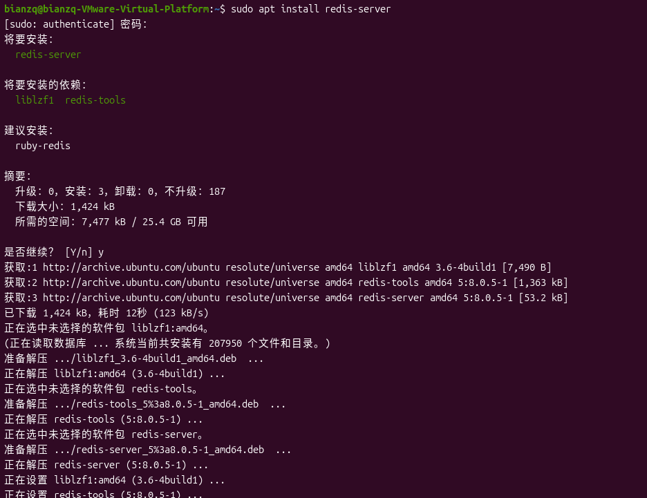
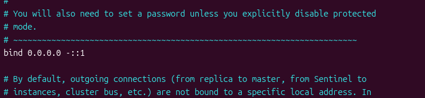
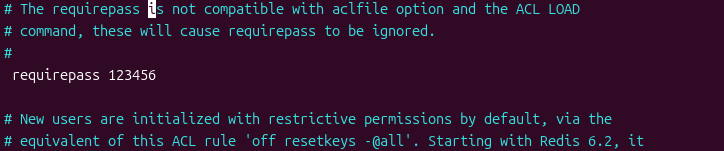
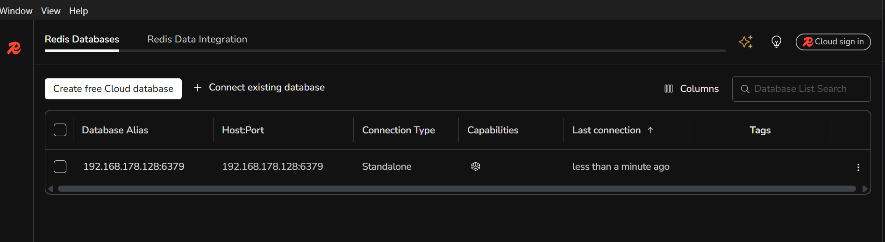

# 第五次实验报告：创建 Redis 服务器

## 第一步：安装 redis-server

```bash
sudo apt install redis-server
```

说明：使用 apt 包管理器安装 Redis 服务器，安装完成后 Redis 会以系统服务的形式运行在 Linux 主机上。



## 第二步：修改 Redis 配置文件

```bash
sudo vim /etc/redis/redis.conf
```

**2.1 允许远程连接**

找到 `bind 127.0.0.1`，将其改为 `bind 0.0.0.0`，使 Redis 监听所有网络接口，允许远程主机连接。



**2.2 设置访问密码**

找到 `# requirepass`，去掉前面的注释符 `#` 并设置密码：`requirepass 123456`，开启密码认证以保证安全。



## 第三步：重启 Redis 服务

```bash
sudo systemctl restart redis-server
```

说明：修改配置文件后，重启 Redis 服务使新的配置生效。

## 第四步：下载 RedisInsight

说明：前往 Redis 官网下载 RedisInsight 图形化客户端，用于远程连接并管理 Redis 服务器。

## 第五步：Connection settings

说明：打开 RedisInsight，在 Connection settings 中填写服务器的 IP 地址和端口号，并输入密码 `123456`。**注意要删掉用户名 default**（使用密码认证时用户名留空），否则会因认证失败而无法连接。



## 第六步：连接成功

说明：设置完成后点击连接，成功进入 Redis 服务器（见上方截图），可以看到连接成功后的界面，至此 Redis 服务器创建完成，并可进行远程访问。
