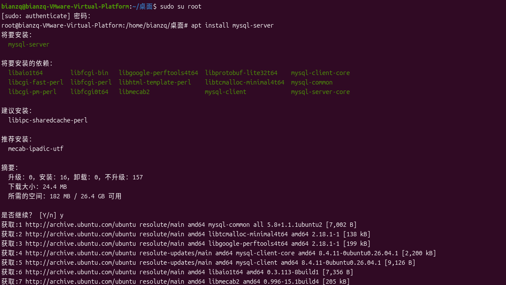
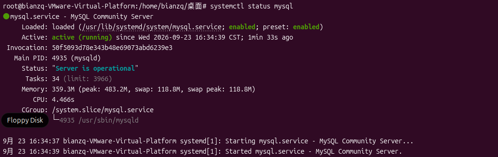
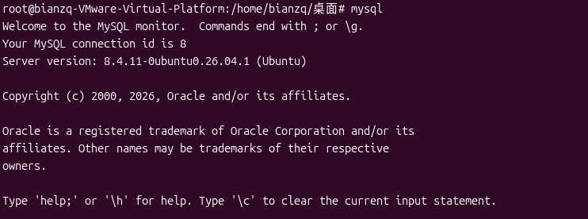
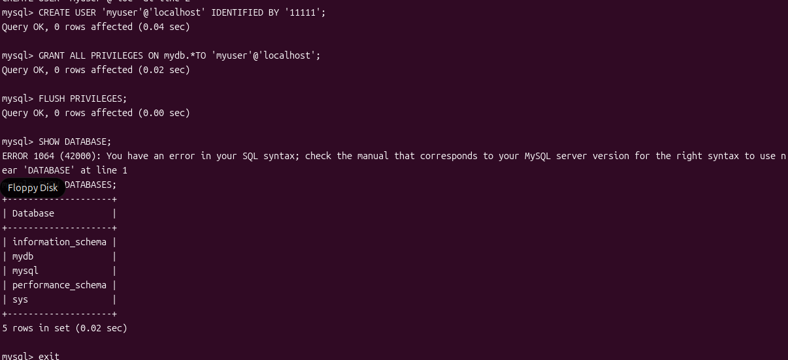
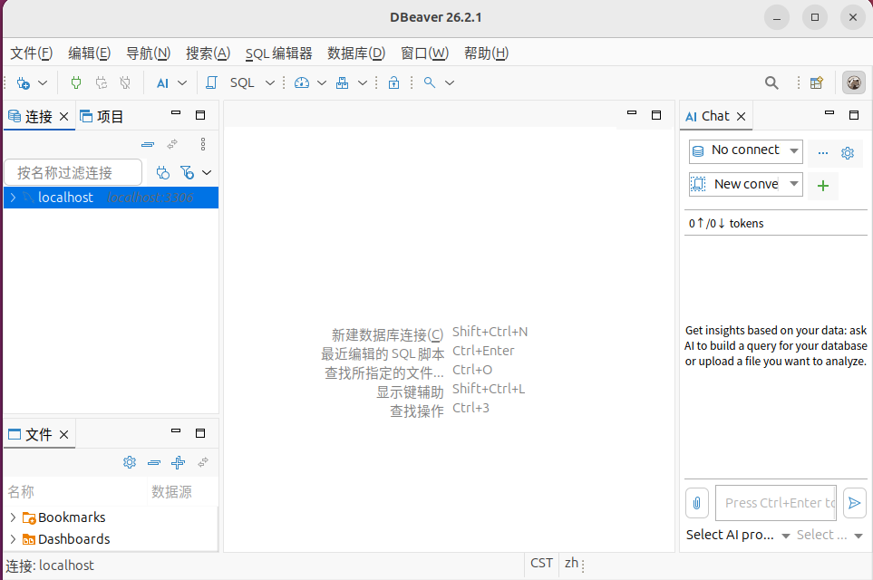

# 搭建第三个服务器 mysql服务器

## 实验目标

搭建mysql服务器。

## 完成清单

| 步骤 | 内容 | 完成情况 |
| ---- | ---- | -------- |
| 步骤1 | 切换管理员 | ✅ 已完成 |
| 步骤2 | 安装mysql-server | ✅ 已完成 |
| 步骤3 | 查看mysql服务状态 | ✅ 已完成 |
| 步骤4 | 进入mysql，创建数据库和用户 | ✅ 已完成 |
| 步骤5 | 安装浏览工具并连接数据库 | ✅ 已完成 |

## 实验步骤

### 步骤1：切换管理员

```bash
sudo su root
```

### 步骤2：安装mysql-server

```bash
apt install mysql-server
```



### 步骤3：查看状态

```bash
systemctl status mysql
```



### 步骤4：进入mysql

输入 `mysql` 进入，然后依次执行以下命令：

```sql
CREATE DATABASE mydb CHARACTER SET utf8mb4 COLLATE utf8mb4_unicode_ci;
CREATE USER 'myuser'@'localhost' IDENTIFIED BY '111111';
GRANT ALL PRIVILEGES ON mydb.* TO 'myuser'@'localhost';
FLUSH PRIVILEGES;
SHOW DATABASES;
exit
```





### 步骤5：安装浏览工具

```bash
snap install dbeaver-ce --classic
```

安装完成后，使用用户 `myuser`、密码 `111111` 连接 `localhost`。



